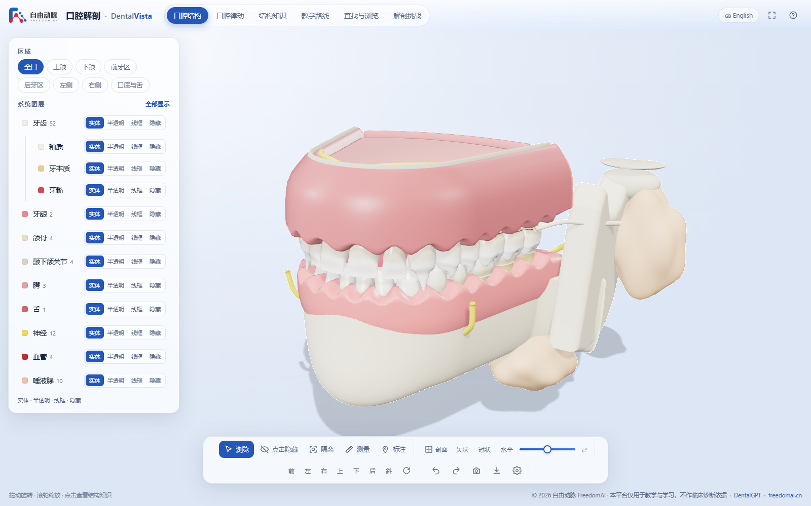

# DentalVista · 口腔解剖

**可交互的三维口腔解剖教学平台 · Interactive 3D oral anatomy for teaching**
by 自由动脉 FreedomAI / [FreedomIntelligence](https://github.com/FreedomIntelligence) — a sibling of [BodyVista](https://freedomintelligence.github.io/BodyVista/).

**Live site: <https://dentalvista.github.io>**  ·  **Demo video (2 min, 中文配音 + 中英字幕): [video/out/DentalVista_demo.mp4](video/out/DentalVista_demo.mp4)**

Everything runs in the browser: no backend, no database. The site is a static Vite build that can be
hosted on GitHub Pages (workflow included). Code is MIT-licensed (see LICENSE).



## What is inside

| Area | Content |
| --- | --- |
| **Model** | 32 permanent + 20 primary teeth (each with enamel, dentine and pulp), upper and lower gingiva with papillae, maxillary alveolar process, mandible body, rami, condyles and articular discs, hard and soft palate with uvula, tongue, inferior alveolar / mental / incisive / lingual / superior alveolar / greater palatine nerves, inferior alveolar / lingual / facial arteries, parotid / submandibular / sublingual glands with their ducts. 94 selectable structures, all in true millimetres. |
| **口腔结构** | Region filter (上颌 / 下颌 / 前牙区 / 后牙区 / 左右侧 / 口底) and per-system layer states: 实体 · 半透明 · 线框 · 隐藏. Teeth can be peeled layer by layer (釉质 / 牙本质 / 牙髓). |
| **结构知识** | A knowledge card for every structure in 中文 and English: overview, location, key points, clinical relevance, related structures, references. Teeth carry FDI / Universal / Palmer codes, eruption and root-completion ages, roots, canals, cusps and average dimensions. |
| **口腔律动** | Five dynamic demonstrations: 咀嚼与开口 (TMJ rotation + translation), 萌出时间轴 (0–22 years, primary → mixed → permanent dentition, with milestones), 龋病进展 (sectioned tooth 36: white spot → cavity → dentine → pulpitis → periapical abscess), 巴氏刷牙法 (animated toothbrush), 牙周炎进展 (recession and bone loss regenerate the gingiva and alveolar bone). |
| **教学路线** | Eight guided lessons: tooth types, FDI numbering, tooth tissues, eruption timetable, inferior alveolar nerve block anatomy, caries, salivary glands, TMJ. Each step sets the camera, layers, section and selection. |
| **查找与浏览** | Search by name (中/英), FDI, Universal or Palmer code; browse by system or region. |
| **解剖挑战** | 5-question rounds in three modes: 结构识别, 解剖寻找 (click it in the model), FDI 编号. Best score is remembered. |
| **Tools** | Hover labels, click to select (blue outline, x-ray outline through other tissue), hide / isolate, measure in mm, numbered annotation pins, sagittal / coronal / transverse section with solid stencil caps, preset views, undo / redo, branded screenshot, GLB export, three backgrounds (柔白 / 暖灰 / 深色), jaw-opening slider, auto-rotate. |
| **AI** | "向 DentalGPT 提问" copies a structured prompt about the selected structure and opens freedomai.cn. |

## Run

```bash
npm install
npm run dev        # http://localhost:5178
npm run build      # static site in dist/
npm run preview
```

Add `?nointro` to the URL to skip the splash and the eruption reveal.

## Pipeline: code → three.js → GLB → Blender

The anatomy is **parametric**, generated in `src/model/` at load time (about 150 ms):

- `tooth.js` — every tooth is lofted from super-elliptic cross-sections with per-type width profiles,
  cusp Gaussians, developmental grooves, a cingulum for anterior teeth and single / bifurcated /
  trifurcated roots. Average dimensions follow Wheeler's Dental Anatomy. Enamel, dentine and pulp are
  separate closed meshes, which is what makes the section caps and the caries demo possible.
- `arch.js` — a Bonwill-Hawley arch (anterior circle + diverging posterior segments), FDI / Universal /
  Palmer numbering, tooth placement with inclinations and curve of Spee, mixed-dentition layout.
- `softtissue.js` — gingiva (scalloped sweeps), alveolar bone, mandible with rami and condyles, palate,
  tongue, nerves, vessels, glands and ducts.

Because the model is code, it can be regenerated at any age (eruption timeline) or disease stage
(periodontitis) and exported anywhere:

```bash
node tools/export-glb.mjs                 # bakes blender/dentalvista.glb (one node per structure)
"D:/tools/blender-4.5.15-windows-x64/blender.exe" -b --python blender/import_glb.py -- \
    blender/dentalvista.glb blender/dentalvista.blend blender/preview.png
```

`blender/import_glb.py` sorts the structures into collections (Teeth / Gingiva / Bone / TMJ / Palate /
Tongue / Nerves / Vessels / Glands), assigns Principled materials, smooths the meshes, saves an editable
`.blend` and renders a preview. The in-app **导出 GLB** button does the same from the browser.

## Visual QA

```bash
npm run shots        # headless Chrome screenshots of scripted views into shots/
```

## Demo video

The demo video is rendered by the site itself: `video/script.json` holds the narration, `node tools/tts.mjs`
synthesises the voice-over (Edge TTS, zh-CN-YunjianNeural), and `node tools/record.mjs` drives the scripted
scenes frame by frame in headless Chrome (GPU) and muxes them with the narration via ffmpeg into
`video/out/DentalVista_demo.mp4`.

`src/main.js` exposes `window.__dv` (app, viewer, model, section, interact, anim and named views)
for scripting and tests.

## Deploy

Push to `main`: `.github/workflows/pages.yml` builds the site and publishes `dist/` to GitHub Pages.
`vite.config.js` uses `base: './'`, so the build also works from any sub-path or straight from disk.

## Credits and notes

- 自由动脉 FreedomAI · DentalGPT ([arXiv 2512.11558](https://arxiv.org/abs/2512.11558)) · [freedomai.cn](https://www.freedomai.cn/)
- Content after Wheeler's Dental Anatomy, Physiology and Occlusion (Nelson), 《口腔解剖生理学》(人民卫生出版社),
  Gray's Anatomy and the FDI two-digit system (ISO 3950).
- Built with three.js and Vite. The model is a parametric schematic built from average dimensions,
  not a scan of an individual, and the platform is for teaching only, not for clinical use.
